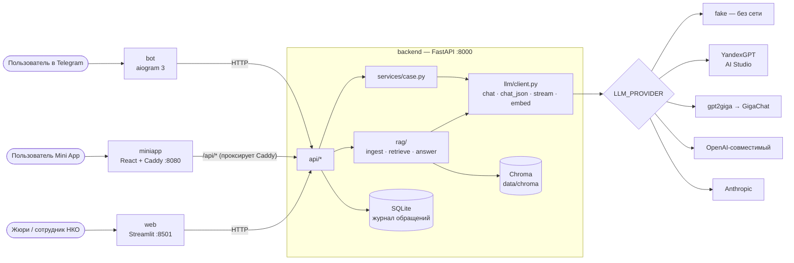
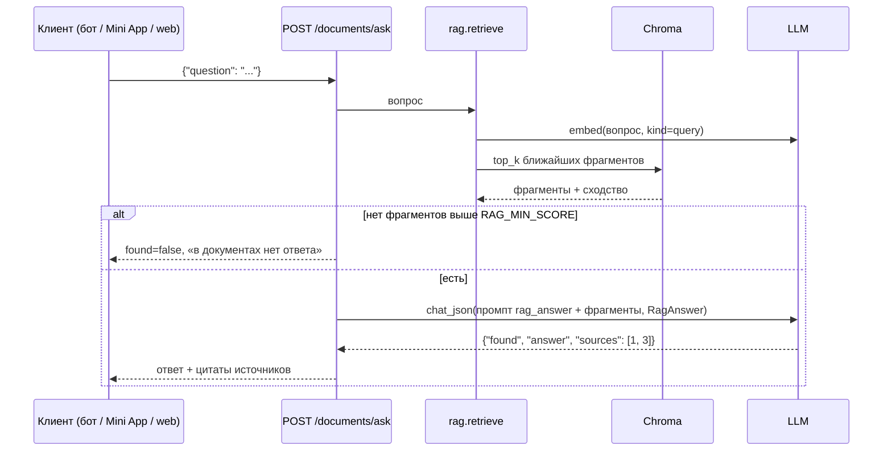

# Архитектура

## Компоненты

В проде перед всем стоит Caddy (`deploy/Caddyfile`): `https://DOMAIN/` → Mini App (и `/api` через неё),
`https://DOMAIN/demo` → Streamlit. Без сервера — `make tunnel` (cloudflared) даёт временный https-адрес.

## Потоки данных

### Вопрос по документам (RAG)

### Загрузка документа

`POST /documents/upload` (или файл в бот) → `data/uploads/` → `rag.ingest.read_text` (PDF/DOCX/XLSX/CSV/TXT/MD)
→ `split_text` (абзацы → чанки ≤ CHUNK_SIZE) → `embed(kind=doc)` → Chroma (`source`, `chunk` в метаданных).
Повторная загрузка файла с тем же именем заменяет его чанки.

### Mini App и авторизация

Telegram открывает Mini App с подписанной строкой `initData`. Фронт шлёт её в заголовке
`X-Telegram-Init-Data`, бэкенд проверяет HMAC токеном бота (`api/telegram_auth.py`).
С `TELEGRAM_AUTH_REQUIRED=true` запросы без валидного initData отклоняются (401).

## Почему так

- **Один слой LLM на OpenAI SDK** — YandexGPT, GigaChat (через gpt2giga), vLLM/Ollama/OpenRouter
  отличаются только `base_url`, ключом и именем модели. Код промптов и сервисов не меняется.
- **`fake`-провайдер** — всё (включая CI и демо интерфейса) работает без ключей; эмбеддинги fake —
  хешированный «мешок слов», поэтому поиск по документам честно работает и без сети.
- **Бот и фронты — только через HTTP к бэкенду** — одна точка для логики, логов и ключей.
- **Caddy внутри контейнера miniapp** — фронт всегда ходит на относительный `/api`: нет CORS
  и разных адресов для локалки, туннеля и прода.
- **Коллекция Chroma на каждый бэкенд эмбеддингов** (`docs_fake`, `docs_yandex`, …) — векторы
  разной размерности не смешиваются; после смены провайдера — `make ingest`.
