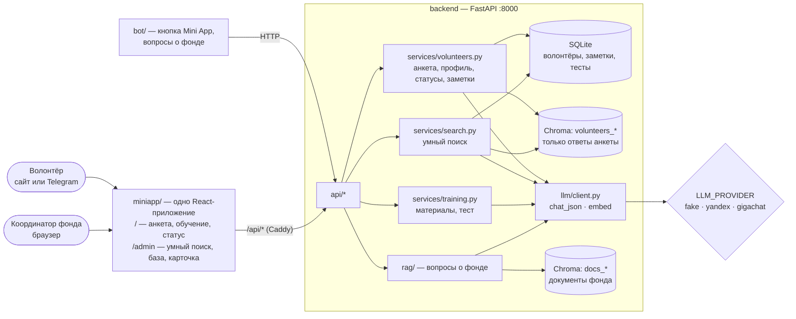
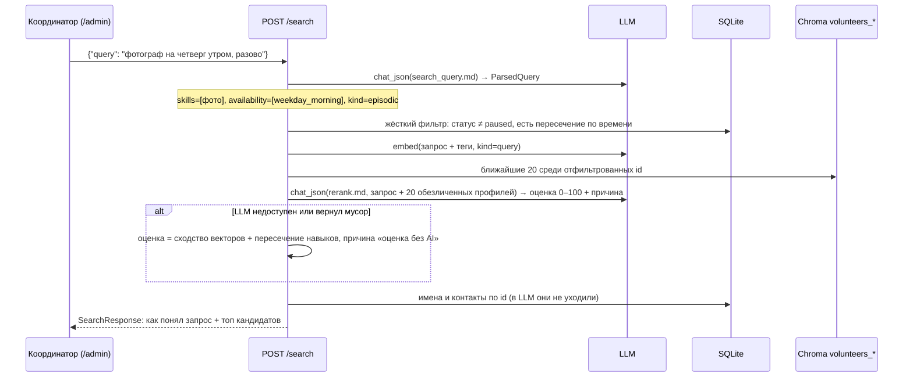

# Архитектура: умный поиск волонтёров «Дети Марии»

Ядро — **умный поиск потенциальных волонтёров** для координатора фонда. Анкета наполняет базу,
обучение отмечает готовность, поиск находит нужных людей по запросу обычными словами.
Кейс и решения — [CASE.md](CASE.md), контракт API — `backend/app/schemas.py`.

## Компоненты



| Папка | Что внутри | Чья зона |
|---|---|---|
| `backend/app/services/volunteers.py` | анкета → профиль (LLM) → БД + индекс; статусы, часы, заметки | A |
| `backend/app/services/search.py` | разбор запроса → фильтр → векторный поиск → переранжирование | A |
| `backend/app/services/training.py` | модули обучения из `data/training/*.md`, генерация и проверка теста | A |
| `backend/app/api/volunteers.py`, `search.py`, `training.py`, `roles.py` | HTTP-обёртки, без логики | A |
| `backend/app/llm/prompts/` | `profile.md`, `search_query.md`, `rerank.md`, `quiz.md` | A |
| `data/roles.json`, `data/training/`, `data/demo/volunteers.json` | роли фонда, учебные тексты, 40 вымышленных анкет | A |
| `miniapp/src/` | экраны волонтёра и `/admin`, клиент `api.ts` | B |
| `deploy/`, `docker/`, `bot/` | деплой, https, бот | B |

## Умный поиск (главный поток)



Почему так:
- **Время — жёсткий фильтр, а не «пожелание» для LLM.** Фонду в первую очередь нужны люди в будни днём;
  галочки времени в анкете надёжнее любого извлечения из текста.
- **Векторы отбирают, LLM объясняет.** Эмбеддинги быстро сужают базу до 20, LLM ставит оценку и пишет
  «почему подходит» — это координатор и видит. Один вызов LLM на запрос, не на каждого кандидата.
- **Без LLM поиск всё равно работает** (фолбэк) — демо не падает из-за сети или лимитов.

## Анкета → профиль

`POST /volunteers` → `services/volunteers.create()`:
1. Сохранить волонтёра в SQLite (имя, контакт, `telegram_id`, ответы), статус `new`.
2. `chat_json(profile.md, ответы + список ролей из data/roles.json)` → `Profile` (навыки, интересы, подходящие роли, резюме).
3. Текст для индекса = ответы + теги профиля (**без имени и контакта**) → `embed(kind=doc)` → Chroma `volunteers_<провайдер>`, id = id волонтёра, в метаданных — время и статус.
4. Ошибка LLM не блокирует анкету: профиль пустой, флаг `profile_ready=false`, переиндексация позже.

## Обучение

- Модули — markdown-файлы в `data/training/` (контент даёт фонд, сейчас черновики).
- `GET /training/{module_id}/quiz` — LLM генерирует 5 вопросов с вариантами по тексту модуля, результат
  кэшируется в БД (правильные ответы на клиент не уходят).
- `POST /training/submit` — проверка, балл в процентах, при ≥ 70% по всем модулям статус → `trained`.

## Статусы волонтёра

```
new (анкета) → training (начал обучение) → trained (тест сдан) → approved (допущен координатором) → active
                                                                         ↘ paused (в любой момент)
```
Переходы `approved`, `active`, `paused` делает только координатор; `training` и `trained` — система.

## Персональные данные

| Данные | Где хранятся | Уходят в LLM / индекс |
|---|---|---|
| Имя, контакт, `telegram_id` | SQLite | **нет** |
| Ответы анкеты, время, род занятий | SQLite | да (фонд разрешил, обезличено) |
| Заметки координатора | SQLite | **нет** (могут содержать истории о подопечных) |

## Остальное (из шаблона)

- **Один слой LLM** (`app.llm.client.get_llm()`) — YandexGPT, GigaChat, OpenAI-совместимые отличаются
  только `.env`. `fake` работает без сети: CI и интерфейс не зависят от ключей.
- **Коллекция Chroma на каждый бэкенд эмбеддингов** (`docs_fake`, `volunteers_yandex`, …) — после смены
  провайдера переиндексировать: `make ingest` для документов, `make seed` для анкет.
- **Mini App и сайт — один код.** В Telegram вход по `initData` (заголовок `X-Telegram-Init-Data`,
  проверка в `api/telegram_auth.py`), в браузере — `volunteer_id` после анкеты в localStorage.
- **Caddy внутри контейнера miniapp** — фронт всегда ходит на относительный `/api`: нет CORS и разных адресов.
  В проде: `https://DOMAIN/` → приложение, `/admin` → кабинет фонда.
