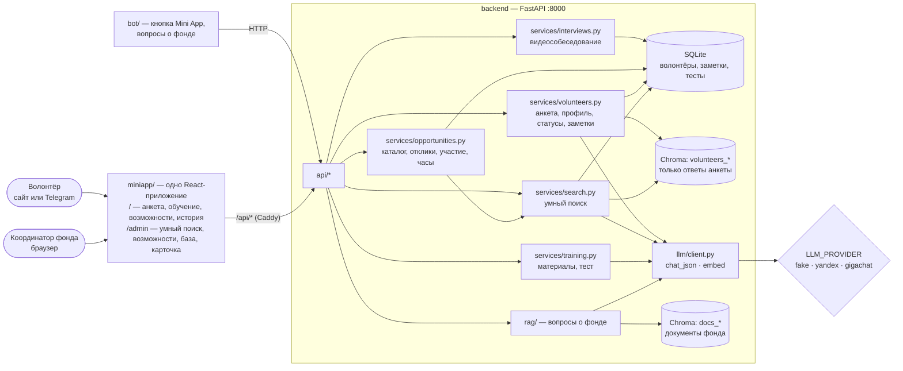
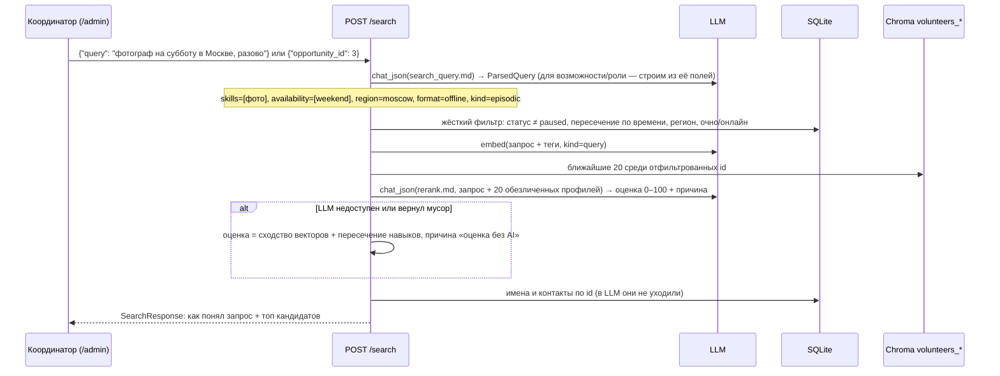

# Архитектура: умный поиск волонтёров «Дети Марии»

Ядро — **умный поиск потенциальных волонтёров** для координатора фонда. Анкета наполняет базу,
обучение отмечает готовность, поиск находит нужных людей по запросу обычными словами.
Кейс и решения — [CASE.md](CASE.md), контракт API — `backend/app/schemas.py`.

## Компоненты



| Папка | Что внутри | Чья зона |
|---|---|---|
| `backend/app/services/volunteers.py` | анкета → профиль (LLM) → БД + индекс; статусы, часы, заметки | A |
| `backend/app/services/search.py` | разбор запроса → фильтр → векторный поиск → переранжирование | A |
| `backend/app/services/training.py` | модули обучения из `data/training/*.md`, генерация и проверка теста | A |
| `backend/app/services/opportunities.py` | каталог возможностей, отклики и приглашения, участие и часы | A |
| `backend/app/services/interviews.py` | видеособеседование: назначение, ссылка в Telegram, логины TURN | A |
| `backend/app/services/chat.py`, `api/messages.py` | переписка фонда с волонтёром (упрощённый чат из Yapp) | A |
| `backend/app/api/volunteers.py`, `search.py`, `training.py`, `roles.py`, `opportunities.py` | HTTP-обёртки, без логики | A |
| `backend/app/api/calls.py` | сигнальный WebSocket звонка (перенесён из Yapp) | A |
| `miniapp/src/call/` | страница звонка `/call/<token>` и WebRTC-комната | A |
| `miniapp/src/messages/Thread.tsx` | переписка — общая для «Сообщений» волонтёра и `/admin/messages` | A |
| `backend/app/llm/prompts/` | `profile.md`, `search_query.md`, `rerank.md`, `quiz.md` | A |
| `data/roles.json`, `data/training/`, `data/demo/volunteers.json` | роли фонда, учебные тексты, 40 вымышленных анкет | A |
| `miniapp/src/` | экраны волонтёра и `/admin`, клиент `api.ts` | B |
| `deploy/`, `docker/`, `bot/` | деплой, https, бот | B |

## Умный поиск (главный поток)



Почему так:
- **Время, регион и формат — жёсткий фильтр, а не «пожелание» для LLM.** Мастерские по субботам и группы
  из интернатов в будни днём, четыре региона — галочки в анкете надёжнее любого извлечения из текста.
  Онлайн-роли регион не фильтруют.
- **Векторы отбирают, LLM объясняет.** Эмбеддинги быстро сужают базу до 20, LLM ставит оценку и пишет
  «почему подходит» — это координатор и видит. Один вызов LLM на запрос, не на каждого кандидата.
- **Без LLM поиск всё равно работает** (фолбэк) — демо не падает из-за сети или лимитов.

## Анкета → профиль

`POST /volunteers` → `services/volunteers.create()`:
1. Сохранить волонтёра в SQLite (имя, контакт, `telegram_id`, ответы), статус `new`.
2. `chat_json(profile.md, ответы + список ролей из data/roles.json)` → `Profile` (навыки, интересы, подходящие роли, резюме).
3. Текст для индекса = ответы + теги профиля (**без имени и контакта**) → `embed(kind=doc)` → Chroma `volunteers_<провайдер>`, id = id волонтёра, в метаданных — время и статус.
4. Ошибка LLM не блокирует анкету: профиль пустой, флаг `profile_ready=false`, переиндексация позже.

## Обучение

- Модули — markdown-файлы в `data/training/` (контент даёт фонд, сейчас черновики). Обязательные и дополнительные:
  `required` из front matter файла; статус `trained` — когда сданы все обязательные.
- `GET /training/{module_id}/quiz` — LLM генерирует 5 вопросов с вариантами по тексту модуля, результат
  кэшируется в БД (правильные ответы на клиент не уходят).
- `POST /training/submit` — проверка, балл в процентах, при ≥ 70% по всем обязательным модулям статус → `trained`.

## Возможности и участие

Возможность — конкретная задача или мероприятие фонда (дата, регион, формат, сколько людей, сколько часов),
обычно создаётся из роли. Связывает подбор с учётом участия:

```
волонтёр откликнулся (responded) ─┐
координатор пригласил (invited) ──┴→ confirmed → attended (часы += hours возможности)
                                              ↘ declined
```
- `GET /opportunities?volunteer_id=` — лента для волонтёра, `recommended` = совпадение навыков/роли, времени и региона (без LLM).
- В `/admin` у возможности кнопка «Подобрать» → `POST /search` с `opportunity_id` → «Пригласить» выбранных.
- `attended` начисляет часы и (если успеем) шлёт благодарность и уведомление в Telegram.

## Видеособеседование

После анкеты координатор знакомится с волонтёром по видео прямо на сайте — без Zoom и аккаунтов.
Перенесено из Yapp: сигнальный сервер (`server/signaling.js` → `api/calls.py`) и комната (`public/room.js` → `miniapp/src/call/room.ts`).

```
карточка в /admin: «Назначить» → POST /volunteers/{id}/interviews → token + ссылка /call/<token> в Telegram
волонтёр: /call/<token>            координатор: /call/<token>?as=coordinator
  GET /calls/{token} → время, ice_servers (STUN, TURN с временным логином)
  WS  /calls/{token}/ws → обмен SDP и ICE; видео и звук идут напрямую между браузерами (или через TURN)
после звонка: PATCH /interviews/{id} {done | canceled}, заметка, статус — как обычно
```
- Статусы волонтёра собеседование не меняет. Через бэкенд видео не проходит и нигде не записывается.
- В комнате два места — координатор и волонтёр; повторный вход того же участника вытесняет старое подключение.
- TURN — coturn Yapp на том же сервере (`TURN_URLS`, `TURN_SECRET`); без него только STUN.

## Сообщения: переписка фонда с волонтёром

Как на hh.ru: координатор видит отклик или кандидата и пишет ему, волонтёр отвечает из личного кабинета.
Упрощено из Yapp (`server/messages.js`): одна переписка на волонтёра, со стороны фонда пишет любой координатор.

```
/admin: «Написать» в карточке волонтёра, у участника занятия, у отклика в «Сводке» → /admin/messages/<id>
волонтёр: «Сообщения» в /me, «Написать координатору» на карточке занятия → /messages
  GET  /dialogs                                  — переписки фонда, свежие сверху, unread от волонтёров
  GET  /volunteers/{id}/dialog?reader=…          — сообщения; unread и «прочитано» глазами reader
  POST /volunteers/{id}/dialog/messages          — {sender, text, opportunity_id?} — «о занятии …»
  POST /volunteers/{id}/dialog/read              — {reader} → сколько непрочитанных осталось
```
- Новые сообщения сайт спрашивает раз в 5 секунд, пока переписка открыта (значки в меню — раз в 20 секунд).
- Координатор написал — волонтёру с Telegram уходит уведомление **без текста**, одно на «пачку» непрочитанных.
- Права, как и во всём API кабинета, не проверяются: `/admin` сайт показывает только координатору.

## Статусы волонтёра

```
new (анкета) → training (начал обучение) → trained (тест сдан) → approved (допущен координатором) → active
                                                                         ↘ paused (в любой момент)
```
Переходы `approved`, `active`, `paused` делает только координатор; `training` и `trained` — система.

## Персональные данные

| Данные | Где хранятся | Уходят в LLM / индекс |
|---|---|---|
| Имя, контакт, `telegram_id` | SQLite | **нет** |
| Ответы анкеты, время, род занятий | SQLite | да (фонд разрешил, обезличено) |
| Заметки координатора | SQLite | **нет** (могут содержать истории о подопечных) |
| Переписка фонда с волонтёром | SQLite | **нет** (в Telegram — только «вам написали», без текста) |

## Почему этот стек (фонд просит обосновать)

| Что | Выбор | Почему |
|---|---|---|
| Бэкенд | Python, FastAPI (open source) | простой читаемый код, Swagger из коробки — фонд и волонтёры-разработчики смогут доделывать |
| База | SQLite → PostgreSQL | на старте — один файл без администрирования; SQLModel переезжает на Postgres сменой строки подключения |
| Векторный поиск | Chroma (open source, локально) | не нужен отдельный платный сервис; анкет у фонда сотни-тысячи — хватает с запасом |
| LLM | YandexGPT или GigaChat | данные остаются в РФ (152-ФЗ), оплата в рублях; слой `llm/` переключается на любой OpenAI-совместимый провайдер через `.env` |
| Интерфейс | React + Vite, один код для сайта и Telegram Mini App, PWA | волонтёры уже в Telegram, пенсионерам удобнее ссылка в браузере; приложение «на экран» без магазинов |
| Уведомления | Telegram-бот | канал, которым фонд уже пользуется; бесплатно |
| Развёртывание | Docker Compose + Caddy (автоматический HTTPS) на любом российском VPS | одна команда `make deploy`, ~500 ₽/мес |

Почему не готовая CRM (Битрикс24, Leader-ID, платформа «Добро.рф»): в них нет подбора по смыслу анкеты и объяснения
«почему подходит», а анкета, обучение и Mini App всё равно требуют доработки. «Добро.рф» оставляем для начисления
часов — выгрузка CSV сейчас, интеграция по API в дорожной карте.

## Остальное (из шаблона)

- **Один слой LLM** (`app.llm.client.get_llm()`) — YandexGPT, GigaChat, OpenAI-совместимые отличаются
  только `.env`. `fake` работает без сети: CI и интерфейс не зависят от ключей.
- **Коллекция Chroma на каждый бэкенд эмбеддингов** (`docs_fake`, `volunteers_yandex`, …) — после смены
  провайдера переиндексировать: `make ingest` для документов, `make seed` для анкет.
- **Mini App и сайт — один код.** В Telegram вход по `initData` (заголовок `X-Telegram-Init-Data`,
  проверка в `api/telegram_auth.py`), в браузере — `volunteer_id` после анкеты в localStorage.
- **Caddy внутри контейнера miniapp** — фронт всегда ходит на относительный `/api`: нет CORS и разных адресов.
  В проде: `https://DOMAIN/` → приложение, `/admin` → кабинет фонда.
