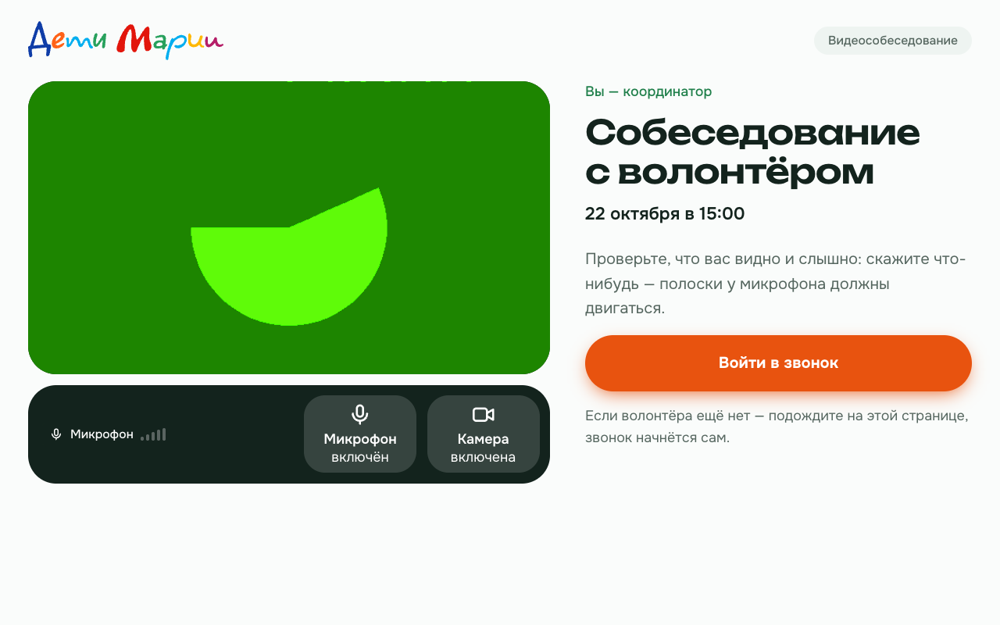
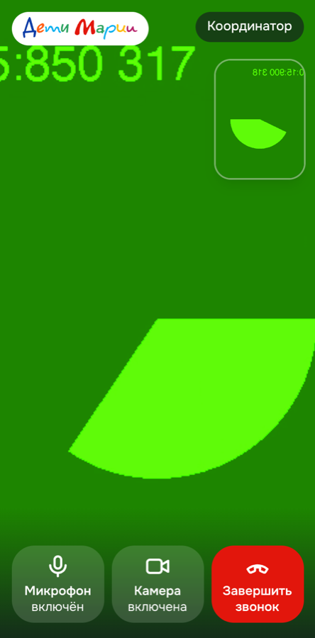
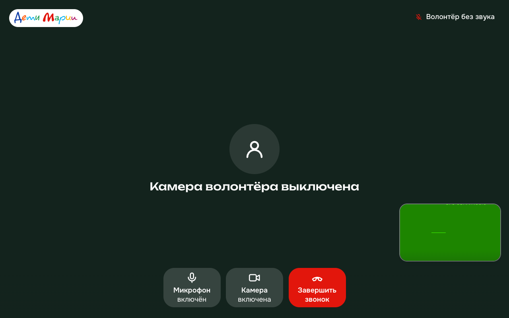

# Страница видеозвонка в новом стиле: прихожая, звонок на весь экран, понятные состояния

| Звонок на телефоне (375px) | У волонтёра выключены камера и микрофон |
|---|---|
|  |  |

На скриншотах — тестовая камера Chrome (зелёный круг), а не человек.

## Что изменилось
- **Прихожая** в стиле T-63: заголовок «Собеседование с координатором / с волонтёром», дата, своё видео и **индикатор микрофона** (пять полосок прыгают, когда человек говорит). Главная кнопка оранжевая, как «Заполнить анкету». Её текст зависит от того, что доступно: «Войти в звонок», «Войти только со звуком» или «Войти без камеры и микрофона».
- **Звонок** на весь экран: собеседник крупно (на телефоне кадр обрезается по экрану, на ноутбуке виден целиком), своё видео — маленьким окном в углу. Внизу три крупные кнопки с иконкой и подписью: «Микрофон включён / выключен», «Камера включена / выключена», «Завершить звонок». Выключенное — белая кнопка с красной зачёркнутой иконкой.
- **Состояния понятным текстом на месте видео:** «Ждём координатора…» / «Ждём волонтёра…» (с подсказкой «Не закрывайте страницу — звонок начнётся сам»), «Соединяемся с координатором…», «Связь прервалась — переподключаемся…», «Камера волонтёра выключена» вместо чёрного прямоугольника, «Волонтёр без звука» в углу.
- **Без тупиков:**
  - нет доступа к камере — объяснение, где её разрешить, кнопки «Попробовать ещё раз» и «Открыть в браузере» (в Telegram), и можно войти только со звуком;
  - соединение не установилось за 20 секунд — «Не получается соединиться…» и кнопка «Переподключиться»;
  - звонок открыт в другой вкладке — «Войти снова»;
  - после «Звонок завершён» — «Вернуться в звонок»;
  - отменённая и неверная ссылка — текст (для неверной — с бэкенда) и ссылка «На главную» / «В кабинет фонда».
- **Место под панель координатора (T-69):** у `CallScreen` проп `sidePanel`, показывается только с `?as=coordinator` — на ноутбуке справа (400px на всю высоту), на телефоне под звонком. По умолчанию пусто. Имени волонтёра на странице нет.

## Где в коде
- `miniapp/src/call/CallScreen.tsx` — логика экранов: прихожая, звонок, итоговые экраны; таймаут соединения; повторный запрос камеры; переподключение (комната пересоздаётся через `key`).
- `miniapp/src/call/parts.tsx` (новый) — оформление: `CallPage` и `PanelLayout` (раскладка с боковой панелью), `Video` и `VideoPlaceholder`, `Controls` (кнопки), `MicLevel` (громкость считается в браузере через Web Audio, звук никуда не уходит), `CtaButton`, `CallMessage`, иконки.
- `miniapp/src/index.css` — в конец добавлены `.mic-bars`, `.call-pulse` (с учётом «уменьшения движения») и белая рамка фокуса на тёмном фоне (`.call-stage`).
- `room.ts`, `api.ts`, контракт и бэкенд не менялись. Новых зависимостей нет.

## Как проверить
Что проверено мной (живой бэкенд локально, `npm run build` проходит):
- **Две вкладки настоящего Chrome** (без окна, с тестовой камерой и микрофоном Chrome): соединение `connected`, видео 640×480 и звук идут в обе стороны (`getStats`: байты и кадры растут). Выключение камеры и микрофона у волонтёра дошло до координатора («Камера волонтёра выключена», «Волонтёр без звука»). После «Завершить звонок» у координатора снова «Ждём волонтёра…».
- **Без камеры** (во встроенном браузере Claude она заблокирована): видна подсказка, кнопка входа меняется на «Войти без камеры и микрофона», «Попробовать ещё раз» снова спрашивает камеру.
- **Тексты:** отменённая ссылка, неверная ссылка («Ссылка на звонок недействительна…» с бэкенда), «Ждём…», «Соединяемся…».
- **Ширина** 375 / 800 / 1024 / 1280px.
- **Клавиатура:** Tab идёт «Микрофон» → «Камера» → «Войти в звонок», рамка фокуса видна, на тёмном фоне она белая.

Во встроенном браузере Claude две вкладки обменялись сигналом, но связь висела в `connecting` — так ведёт себя его сеть. На этом и найден случай «зависло без ошибки», для него добавлен таймаут.

### Проверка на двух настоящих устройствах (сделать до демо, @gordeymos)
1. Убедиться, что PR смержен и деплой прошёл (Actions → Deploy зелёный). TURN: `https://deti.201-34-157-90.sslip.io/api/calls/<token>` должен вернуть в `ice_servers` строку `turn:` с `username` и `credential` (см. T-75).
2. Назначить собеседование: в `/admin` → карточка любого демо-волонтёра → «Назначить» (T-60). Если кнопки ещё нет — Swagger `https://deti.201-34-157-90.sslip.io/api/docs` → `POST /volunteers/{id}/interviews` с `{"starts_at": "2026-10-22T15:00:00+03:00"}`. Из ответа взять `token`.
3. **Ноутбук (координатор), Chrome:** `https://deti.201-34-157-90.sslip.io/call/<token>?as=coordinator` → разрешить камеру и микрофон → «Войти в звонок» → должно быть «Ждём волонтёра…».
4. **Телефон (волонтёр):** `https://deti.201-34-157-90.sslip.io/call/<token>` по очереди:
   - а) в обычном браузере (Safari / Chrome) по **Wi-Fi**;
   - б) так же, но **Wi-Fi выключен, мобильный интернет** — это проверка TURN;
   - в) **в Telegram**: ссылка из сообщения бота или открыть Mini App и вставить путь. Если камера в Telegram недоступна — должна появиться кнопка «Открыть в браузере».
5. Что проверить в каждом случае:
   - видите и слышите друг друга (проще всего на одной громкости в разных комнатах);
   - выключили камеру — у собеседника «Камера … выключена»;
   - выключили микрофон — у собеседника «… без звука»;
   - «Завершить звонок» — у второго «Ждём …»;
   - «Вернуться в звонок» снова соединяет.
6. Сделать скриншот звонка с живыми людьми для питча — заменить `img/T-74-call-phone.png`.
7. **Если не соединяется** (висит «Соединяемся…» или «Не получается соединиться»): на ноутбуке открыть `chrome://webrtc-internals` в соседней вкладке, повторить вход и прислать скриншот блока с `iceConnectionState` и списком candidate-pair; плюс консоль (F12 → Console) с обеих сторон, если на телефоне Android — через `chrome://inspect`. Записать в Issue #74, какая сеть была (Wi-Fi / мобильный, оператор).

## Что осталось и на что обратить внимание
- Проверка на двух настоящих устройствах на проде — за @gordeymos по инструкции выше (поэтому в PR `Refs #74`, а не `Closes`).
- **T-69:** панель «План / Итог» передаётся в `<CallScreen token={…} sidePanel={<…/>} />` в `App.tsx`. Раскладка (справа на ноутбуке, снизу на телефоне) уже есть, панель видна и в прихожей, и после «Звонок завершён» — удобно записать итог.
- Индикатор микрофона в Safari может ожить только после первого касания страницы (политика звука браузера) — это нормально.
